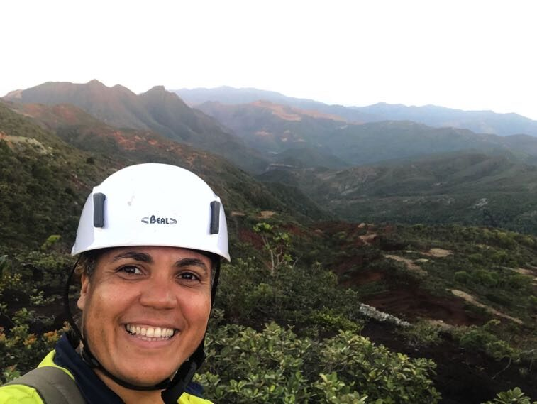
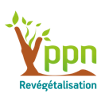
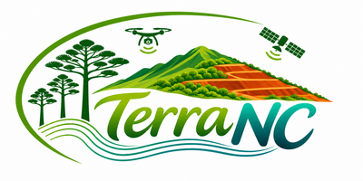

::: {.grid}
::: {.g-col-12 .g-col-md-8}
J'ai consacré vingt ans à la réhabilitation de sites dégradés en Nouvelle-Calédonie.
Mon expertise couvre la gestion de projets environnementaux, 
la revégétalisation de sites miniers et la restauration de la forêt sèche.
Forte d’une expérience en gestion d’entreprise et en coordination de chantiers de grande
envergure, je souhaite aujourd’hui mettre mes compétences au service de structures
spécialisés dans la conception et la réalisation de projets environnementaux.

En 2023, j'ai repris des études pour adosser à cette expérience de terrain
la maîtrise des données : géomatique, télédétection et analyse spatiale.
En 2026, cette double compétence s'est concrétisée par la conception et le
développement d'une application web de diagnostic de déforestation chez Nitidæ N'Lab, à Montpellier.
:::
::: {.g-col-12 .g-col-md-4}
{style="border-radius: 14px;"}
:::
:::
Mes trois entreprises calédoniennes :

::: {style="background: #ffffff; border-radius: 14px; padding: 1.25rem; box-shadow: 0 2px 12px rgba(22,63,57,.10);"}
::: {.grid style="align-items: center;"}
::: {.g-col-4 style="text-align: center;"}
{width=90 fig-alt="Logo PPN Revégétalisation"}
:::
::: {.g-col-4 style="text-align: center;"}
{width=110 fig-alt="Logo Green Farm"}
:::
::: {.g-col-4 style="text-align: center;"}
{width=150 fig-alt="Logo Terra NC"}
:::
:::
:::
## Formations

- Mastère Spécialisé SILAT — AgroParisTech _  Montpellier
Systèmes d'Information Localisés pour l'Aménagement des Territoires (en cours)
- Master international ST2AE-GEEFT Option Data Manager, 
Institut Agro Montpellier - AgroParisTech _  Montpellier (2023-2025)
- Télépilote de drone, CATS _Formadrone (2026)
- Agrément animateur de formation _ CNAM (2021)
- Management général avancé,CESA Dirigeants de PME - HEC Paris (2013–2015) ·  
- BTSA Agronomie Tropicale _ LEGTA Guadeloupe (2000)

<!-- Lien CV à activer quand le PDF sera dans le dépôt :
[Télécharger mon CV (PDF)](cv_julia_lerno-causse.pdf) -->