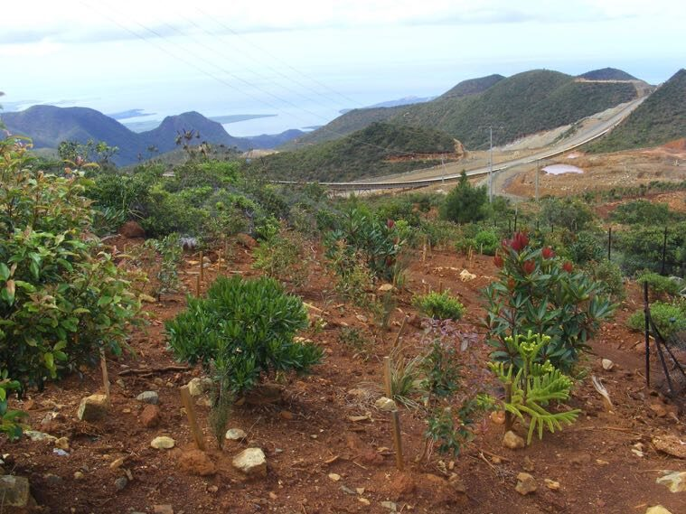
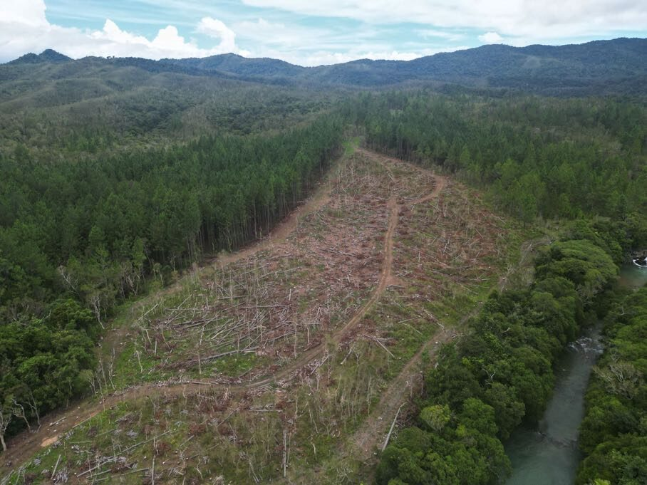
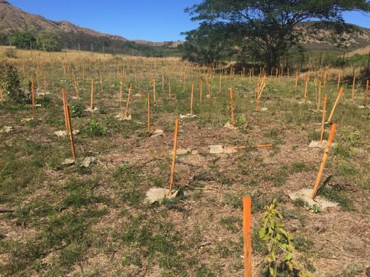

::: {.hero}

:::

Vingt ans de terrain en Nouvelle-Calédonie — réhabilitation de sites miniers,
restauration de forêt sèche, production de plants endémiques — complétés par
une spécialisation en géomatique et télédétection (Mastère Spécialisé SILAT,
Montpellier).

J'aide les collectivités, les entreprises et les bureaux d'études à concevoir,
conduire et suivre leurs projets environnementaux, du diagnostic de terrain à
l'application de suivi.

::: {.grid}

::: {.g-col-12 .g-col-md-4 .card}

### Agronomie & réhabilitation écologique

Restauration de milieux dégradés, revégétalisation, gestion des espèces
envahissantes, conduite de chantiers et d'équipes.
:::

::: {.g-col-12 .g-col-md-4 .card}

### Géomatique & télédétection

Cartographie, analyse spatiale, suivi de la végétation par imagerie
satellitaire, du drone au satellite.
:::

::: {.g-col-12 .g-col-md-4 .card}

### Applications & données

Structuration de données environnementales, applications web de diagnostic,
rapports automatisés.
:::

:::

[Mes prestations](prestations.qmd) · [Mes réalisations](realisations.qmd) · [Me contacter](contact.qmd)