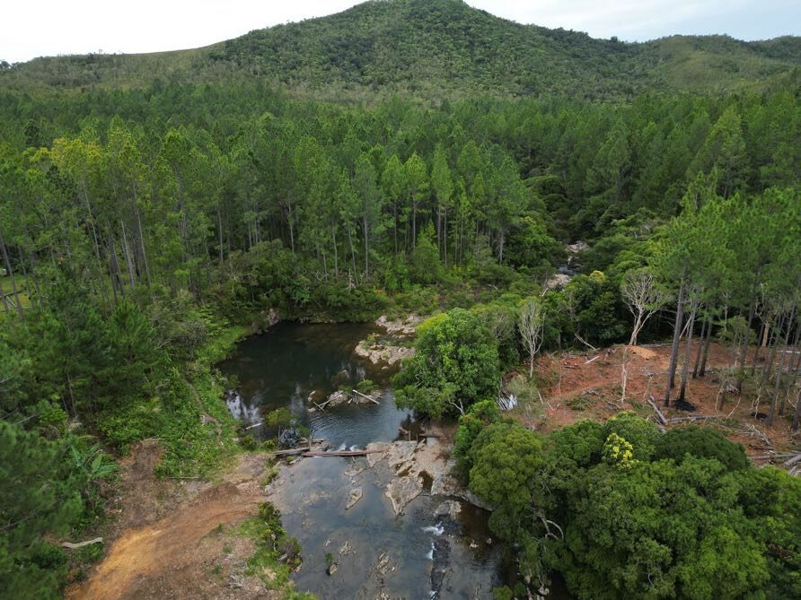

::: {.hero}

:::

Vingt ans de terrain en Nouvelle-Calédonie — sites miniers, forêt sèche,
plants endémiques — complétés par une spécialisation en géomatique et
télédétection (Mastère Spécialisé SILAT, Montpellier). J'accompagne
collectivités, entreprises et bureaux d'études, du diagnostic de terrain
à l'application de suivi.

::: {.grid}

::: {.g-col-12 .g-col-md-4 .card}

### Agronomie & réhabilitation écologique

Restauration de milieux dégradés, revégétalisation, gestion des espèces
envahissantes, conduite de chantiers et d'équipes.
:::

::: {.g-col-12 .g-col-md-4 .card}

### Géomatique & télédétection

**Du satellite à la plante.** Imagerie satellitaire et drone, analyse
spatiale, suivi de la végétation — interprétés en écologue de terrain.
:::

::: {.g-col-12 .g-col-md-4 .card}

### Applications & données

Structuration de données environnementales, applications web de diagnostic,
rapports automatisés.
:::

:::
