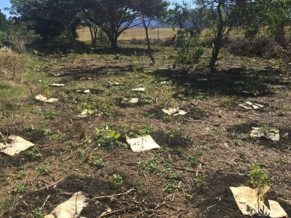
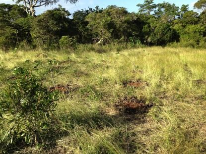
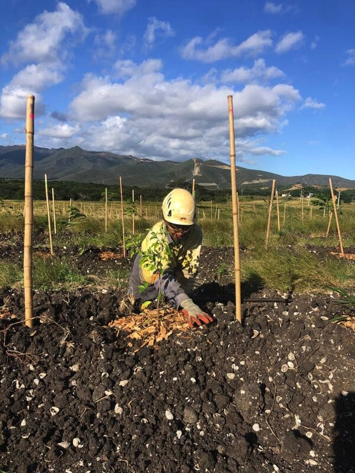

::: {.hero}

:::

Des prestations qui relient le terrain et la donnée — et, pour chaque mission,
des livrables vérifiables.

## Suivi de la végétation de vos sites

::: {.grid}

::: {.g-col-12 .card}
Vous êtes responsable d'un site — concession minière, parcelles
revégétalisées, aire protégée, périmètre de captage — et vous devez rendre
compte de l'évolution de sa végétation.

J'établis un état zéro à une date de référence, puis je suis les changements
à intervalle convenu, en croisant imagerie satellitaire (Sentinel-2), drone
et relevés de terrain — interprétés en écologue : ce qui s'installe, ce qui
régresse, ce qui doit être repris.

**Vous recevez :** un rapport par site, auditable (images sources et dates,
incertitudes explicites), les couches SIG réutilisables dans vos outils et
une synthèse décideur d'une page.

**Pour qui :** mineurs et sous-traitants, provinces et observatoires,
gestionnaires d'aires protégées, organismes de reboisement, bureaux d'études.

**L'atout Terra NC :** vingt ans de chantiers de revégétalisation en
Nouvelle-Calédonie (2001-2023) — j'interprète ce que les images montrent
parce que j'ai planté, suivi et réceptionné ces chantiers sur le terrain.

**Modalités :** état zéro au forfait, puis suivi périodique (annuel ou
saisonnier).
:::

:::

## Conseil, diagnostic et formation

::: {.grid}

::: {.g-col-12 .g-col-md-4 .card}

### Réhabilitation écologique — conseil et accompagnement

Plans de restauration, choix d'espèces et d'itinéraires techniques, suivi et
réception de chantiers, gestion des espèces envahissantes.

*Pour qui : mineurs et sous-traitants, collectivités, associations.*
:::

::: {.g-col-12 .g-col-md-4 .card}

### Diagnostic territorial, cartographie et données

État des lieux d'un site ou d'un territoire, SIG et cartographie thématique,
structuration de données, indicateurs — jusqu'à l'application web sur mesure
qui automatise les rapports.

*Pour qui : collectivités, bureaux d'études, gestionnaires d'espaces naturels.*
:::

::: {.g-col-12 .g-col-md-4 .card}

### Formation et transfert

Techniques de restauration écologique, outils SIG, chantiers-écoles,
accompagnement des équipes vers l'autonomie.

*Pour qui : équipes techniques, organisations professionnelles.*
:::

:::

## Comment on travaille ensemble

::: {.grid}

::: {.g-col-12 .g-col-md-4 .card}
### 1. Échange de cadrage

Un premier échange, sans engagement, pour comprendre votre besoin, votre
contexte et vos contraintes.
:::

::: {.g-col-12 .g-col-md-4 .card}
### 2. Proposition

Une proposition écrite : objectifs, méthode, livrables et nombre de jours.
:::

::: {.g-col-12 .g-col-md-4 .card}
### 3. Mission

Réalisation, points d'étape convenus, livraison — et transfert pour que vos
équipes restent autonomes.
:::

:::

Quatre formats selon le besoin : étude ponctuelle, suivi périodique,
sous-traitance d'un bureau d'études, renfort temporaire d'équipe.

Chaque mission commence par un échange sur votre besoin.

::: {style="text-align: center;"}
[Contactez-moi](contact.qmd){.btn .btn-primary}
:::

{width=160 fig-alt="Logo Terra NC"}

Prestations portées par **Terra NC**
