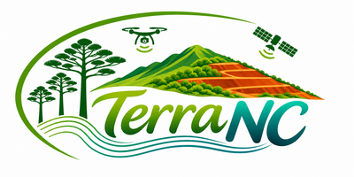

::: {.hero}

:::

Des prestations qui relient le terrain et la donnée.

::: {.grid}

::: {.g-col-12 .g-col-md-6 .card}
### Diagnostics territoriaux et cartographie

État des lieux d'un site ou d'un territoire, cartographie thématique,
indicateurs pour l'aide à la décision.
:::

::: {.g-col-12 .g-col-md-6 .card}
### Suivi de végétation par télédétection

Suivi de revégétalisation, de reboisement ou de couvert forestier par
imagerie satellitaire (Sentinel-2) et drone, avec analyse de séries
temporelles.
:::

::: {.g-col-12 .g-col-md-6 .card}
### Réhabilitation écologique — conseil et accompagnement

Plans de restauration, choix d'espèces et d'itinéraires techniques,
suivi de chantiers, formation des équipes.
:::

::: {.g-col-12 .g-col-md-6 .card}
### Structuration de données et SIG

Mise en qualité et organisation de données environnementales, bases de
données spatiales, projets QGIS multi-thématiques.
:::

::: {.g-col-12 .g-col-md-6 .card}
### Applications web de diagnostic

Conception d'applications sur mesure (R Shiny) pour traiter des lots de
parcelles, croiser des sources cartographiques et produire des rapports
automatisés.
:::

::: {.g-col-12 .g-col-md-6 .card}
### Formation

Conception et animation de formations : techniques de restauration
écologique, outils SIG, publics professionnels et adultes.
:::

:::

## Nous avons travaillé ensemble

::: {.grid}

::: {.g-col-12 .g-col-md-4 .card}
« Mme Lerno-Causse a démontré une grande capacité d'analyse des enjeux et
une expertise technique pointue. Son engagement et son professionnalisme
ont été remarquables. »

**Julie Petit** — Coordinatrice PROTEGE NC, CPS Communauté du Pacifique
:::

::: {.g-col-12 .g-col-md-4 .card}
« Julia Lerno-Causse a apporté son expertise dans la revégétalisation de
sites miniers. Son savoir-faire et sa gestion efficace des équipes ont été
des atouts majeurs. »

**Jean-Louis Thydjepache** — Chef de département RSE, Koniambo Nickel SAS
:::

::: {.g-col-12 .g-col-md-4 .card}
« Mme Lerno-Causse est dynamique, extrêmement enjouée et agréable, dotée
d'une personnalité chaleureuse et toujours prête à aider les autres.
C'est une personne fiable avec qui il est agréable de travailler. »

**Hortence Lecercle** — Cheffe de projets, OFB Nouvelle-Calédonie

:::

:::

Chaque mission commence par un échange sur votre besoin —
[contactez-moi](contact.qmd).

{width=160 fig-alt="Logo Terra NC"}

Prestations portées par **Terra NC**
