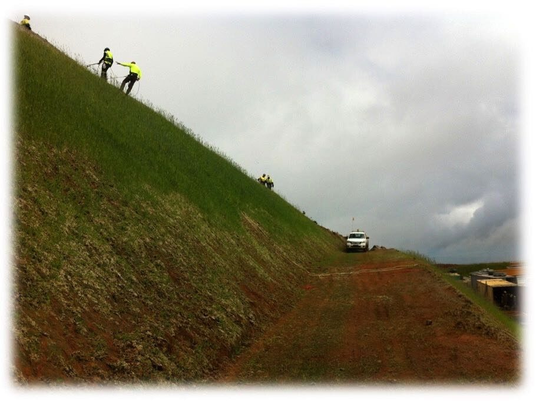

::: {.hero}

:::

Des prestations qui relient le terrain et la donnée — et, pour chaque mission,
des livrables vérifiables.

## Suivi de revégétalisation et d'emprises

::: {.grid}

::: {.g-col-12 .card}
Vous êtes responsable d'une emprise — concession minière, parcelles
revégétalisées, aire protégée, périmètre de captage — et vous devez rendre
compte de l'évolution de sa végétation à une administration, un bailleur ou
votre direction.

J'établis un état zéro de la végétation à une date de référence, puis je suis
les changements à intervalle convenu, en croisant imagerie satellitaire
(Sentinel-2), drone et relevés de terrain. J'interprète les évolutions en
écologue de terrain : ce qui s'installe, ce qui régresse, ce qui doit être
repris.

**Vous recevez :**

- un rapport par emprise, auditable : images sources et dates, règles de
  décision, incertitudes explicites ;
- les couches SIG, livrées et réutilisables dans vos outils ;
- une synthèse décideur d'une page.

**Pour qui :** mineurs et sous-traitants de revégétalisation, provinces et
observatoires, organismes de reboisement, gestionnaires d'aires protégées,
bureaux d'études en sous-traitance.

**Ce que Terra NC apporte de particulier :** vingt ans de conduite de chantiers
de revégétalisation en Nouvelle-Calédonie (2001-2023). J'interprète ce que les
images montrent parce que j'ai planté, suivi et réceptionné ces chantiers sur
le terrain.

**Modalités :** état zéro en forfait, puis suivi à rendez-vous périodique
(annuel ou saisonnier). Chaque mission commence par un échange de cadrage.
:::

::: {.g-col-12 .g-col-md-8 .card}
« Julia Lerno-Causse a apporté son expertise dans la revégétalisation de
sites miniers. Son savoir-faire et sa gestion efficace des équipes ont été
des atouts majeurs. »

**Jean-Louis Thydjepache** — Chef de département RSE, Koniambo Nickel SAS
:::

:::

## Conseil, diagnostic et formation

::: {.grid}

::: {.g-col-12 .g-col-md-4 .card}
### Réhabilitation écologique — conseil et accompagnement

Plans de restauration, choix d'espèces et d'itinéraires techniques, suivi et
réception de chantiers, gestion des espèces envahissantes.

*Pour qui : mineurs et sous-traitants, collectivités, associations.*
:::

::: {.g-col-12 .g-col-md-4 .card}
### Diagnostic territorial, cartographie et données

État des lieux d'un site ou d'un territoire, structuration de données
environnementales, SIG, cartographie thématique, indicateurs — et, quand le
besoin le justifie, application web sur mesure pour traiter des lots de
parcelles et automatiser les rapports.

*Pour qui : collectivités, bureaux d'études, gestionnaires d'espaces naturels.*
:::

::: {.g-col-12 .g-col-md-4 .card}
### Formation et transfert

Techniques de restauration écologique, outils SIG, chantiers-écoles,
accompagnement des équipes vers l'autonomie.

*Pour qui : équipes techniques, organisations professionnelles.*
:::

::: {.g-col-12 .g-col-md-8 .card}
« Mme Lerno-Causse a démontré une grande capacité d'analyse des enjeux et
une expertise technique pointue. Son engagement et son professionnalisme
ont été remarquables. »

**Julie Petit** — Coordinatrice PROTEGE NC, CPS Communauté du Pacifique
:::

:::

## Comment on travaille ensemble

::: {.grid}

::: {.g-col-12 .g-col-md-4 .card}
### 1. Échange de cadrage

Un premier échange, sans engagement, pour comprendre votre besoin, votre
contexte et vos contraintes.
:::

::: {.g-col-12 .g-col-md-4 .card}
### 2. Proposition

Une proposition écrite : objectifs, méthode, livrables et nombre de jours.
:::

::: {.g-col-12 .g-col-md-4 .card}
### 3. Mission

Réalisation, points d'étape convenus, livraison — et transfert pour que vos
équipes restent autonomes.
:::

:::

Quatre formats selon le besoin : étude ponctuelle, suivi périodique,
sous-traitance d'un bureau d'études, renfort temporaire d'équipe.

Chaque mission commence par un échange sur votre besoin —
[contactez-moi](contact.qmd).

{width=160 fig-alt="Logo Terra NC"}

Prestations portées par **Terra NC**
