Une sélection de projets menés au sein de mes entreprises en Nouvelle-Calédonie (2003-2023),\

puis dans le cadre de ma spécialisation en géomatique (depuis 2023).

Cliquez sur une photo pour l'agrandir.

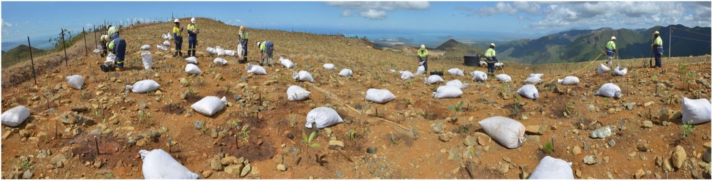

## Réhabilitation écologique — Nouvelle-Calédonie

::: {.grid}
::: {.g-col-12 .g-col-md-7}
### Restauration de la forêt sèche
Côte Ouest Vavouto, (2009-2020) pour Koniambo Nickel SAS.

Production et plantation de plus de 25 000 plants par an, 
semences collectées aux abords des zones à restaurer, 
expérimentation d'itinéraires techniques et mise en défens anti-cerfs.
:::
::: {.g-col-12 .g-col-md-5}
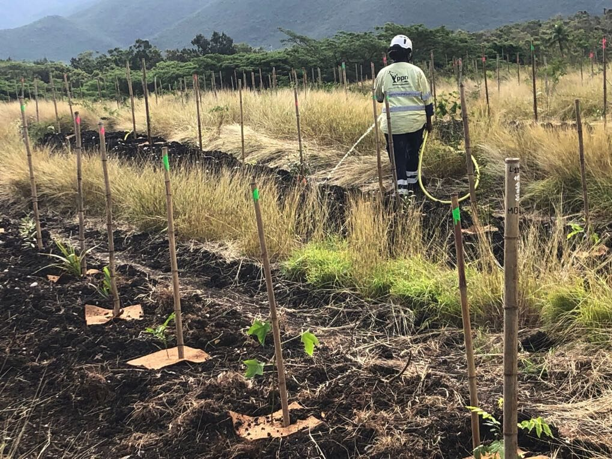

:::
:::

::: {.grid}
::: {.g-col-12 .g-col-md-12}
### Réhabilitation du bassin versant du creek Mindaï
Tribu de Bâ, Houaïlou, (2021-2023) commune de Houaïlou, projet PROTEGE.
Suppression de 10 ha de pins envahissants, 
reboisement de 12 ha avec 12 000 plants endémiques, 
2 000 mètres de clôtures anti-cerfs et cochons,
participation des populations locales aux plantations et au suivi.
:::
::: {.g-col-12 .g-col-md-5}
:::
:::

::: {.grid}
::: {.g-col-8 .g-col-md-12}
### Revégétalisation du maquis minier
2003-2023, acteurs miniers et collectivités (KNS, Ballande, NMC...).

Production annuelle de 80 000 plants endémiques,
plantation de 30 000 plants par an, 
semis hydraulique (20 000 m² par an), 
pose de boudins et géofilets, travaux sur corde, 
suivi phénologique d'espèces rares.
:::
::: {.g-col-12 .g-col-md-6}

:::
::: {.g-col-12 .g-col-md-6}
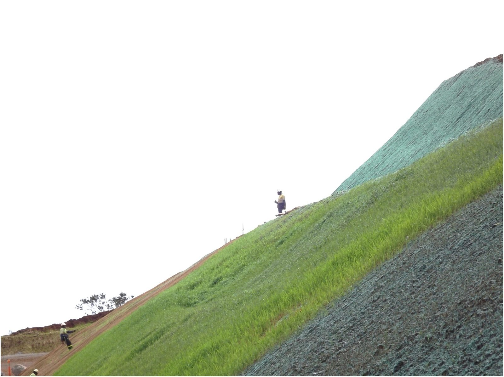
:::
:::

::: {.grid}
::: {.g-col-6 .g-col-md-6}
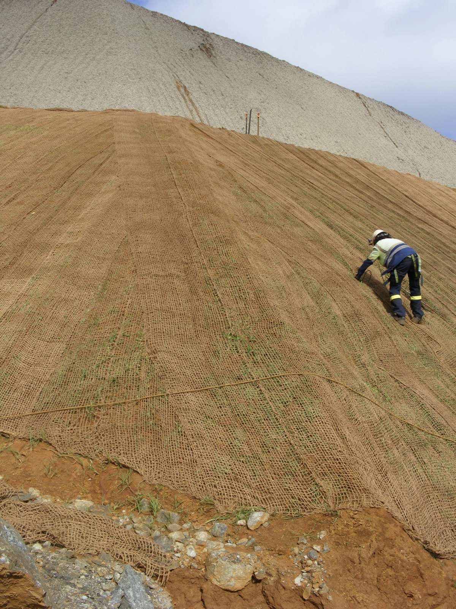
:::
::: {.g-col-6 .g-col-md-6}
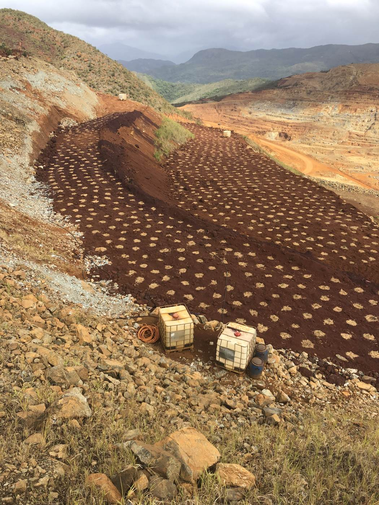
:::

:::
:::

::: {.grid}
::: {.g-col-12 .g-col-md-7}
### Production de plants endémiques
Pépinières de Kataviti (Koné) et de la tribu de Tiwae (Touho), 2003-2023.
Capacité de 200 000 plants, environ 300 espèces produites, 
recherche surla multiplication des espèces endémiques.
:::
::: {.g-col-12 .g-col-md-5}

:::
::: {.g-col-12 .g-col-md-18}

:::
:::

## Formation & accompagnement

::: {.grid}
::: {.g-col-12 .g-col-md-12}
### Formations aux métiers du végétal et de la restauration écologique
CFPPA de Pouembout (2010-2020), environ 50 h par an, 8 à 12 apprenants par module :

semis, greffage, repiquage, collecte de semences, reconnaissance d'espèces, plantation.
:::
::: {.g-col-12 .g-col-md-12}
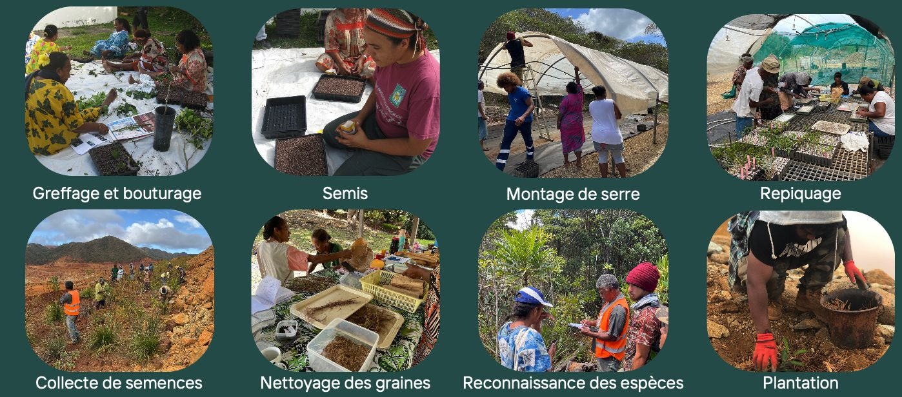
:::
:::

::: {.grid}
::: {.g-col-12 .g-col-md-}
### Chantier école de revégétalisation
Ancien site minier de Bel-Air, Houaïlou, 2022 — Fonds Nickel, DIMENC.
3 238 plants d'espèces indigènes et endémiques, 1 821 m² de semis
hydraulique, formation des participants aux techniques de plantation.
:::
::: {.g-col-12 .g-col-md-6}
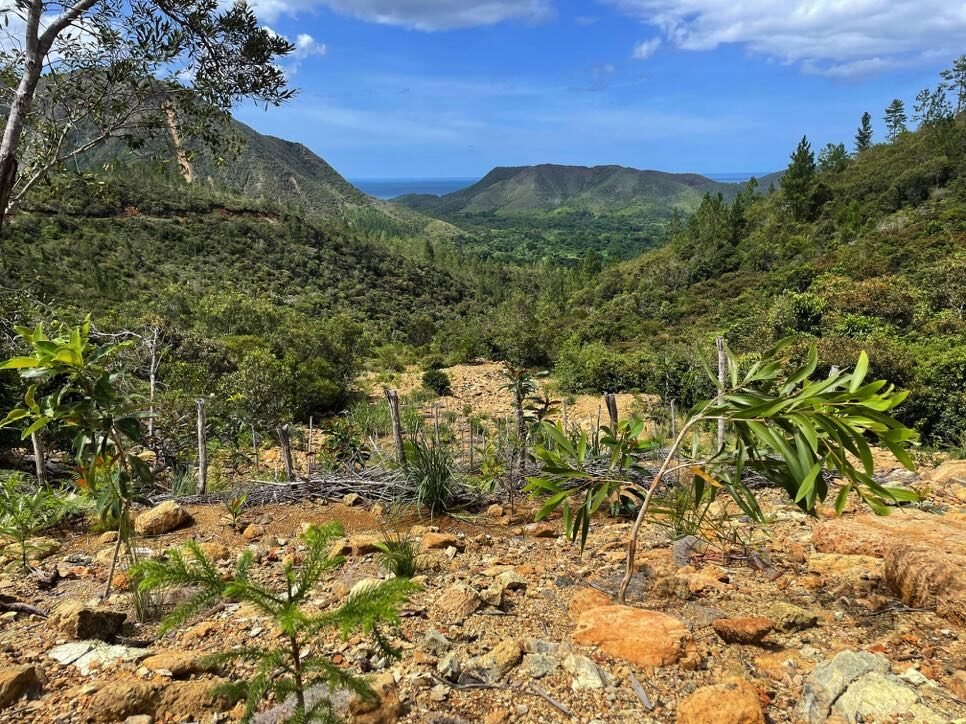
:::
::: {.g-col-12 .g-col-md-6}
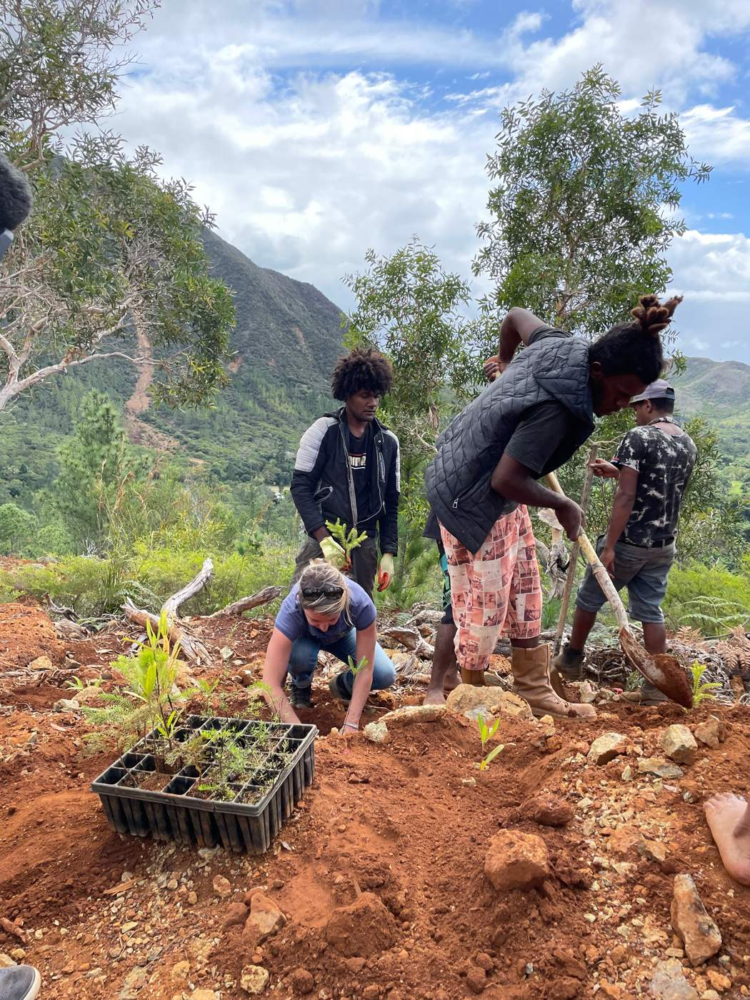
:::
:::

## Géomatique & applications

### Application web de diagnostic de déforestation
Mission professionnelle, Nitidæ, Montpellier, 2026-2027.
Conception et développement d'une application de diagnostic
« zéro-déforestation » sur parcelles cultivées, dans le contexte du
règlement européen RDUE : croisement de cartes forestières de référence,
traitement de lots de plusieurs milliers de parcelles, rapports
automatisés, protection des données personnelles.

::: {.grid}
::: {.g-col-12 .g-col-md-7}
### Cartographie et suivi par drone et satellite
Terra Native Consulting, depuis 2023.
Production de cartes et d'images drone et satellite pour le suivi de projets environnementaux.
:::
::: {.g-col-12 .g-col-md-5}

:::
:::

::: {.grid}
::: {.g-col-6 .g-col-md-4}
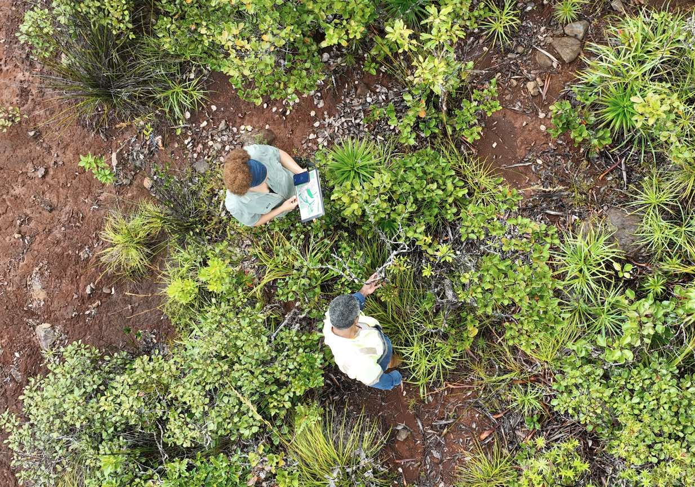
:::

::: {.g-col-6 .g-col-md-4}
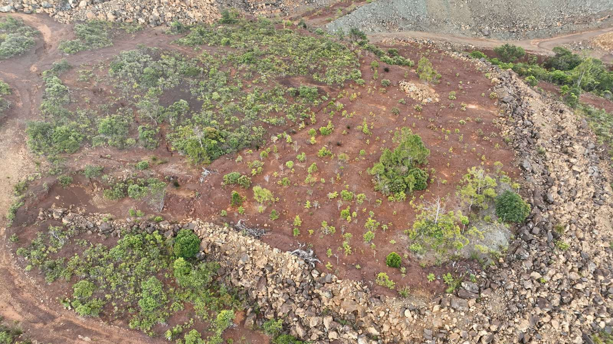
:::
::: {.g-col-6 .g-col-md-4}
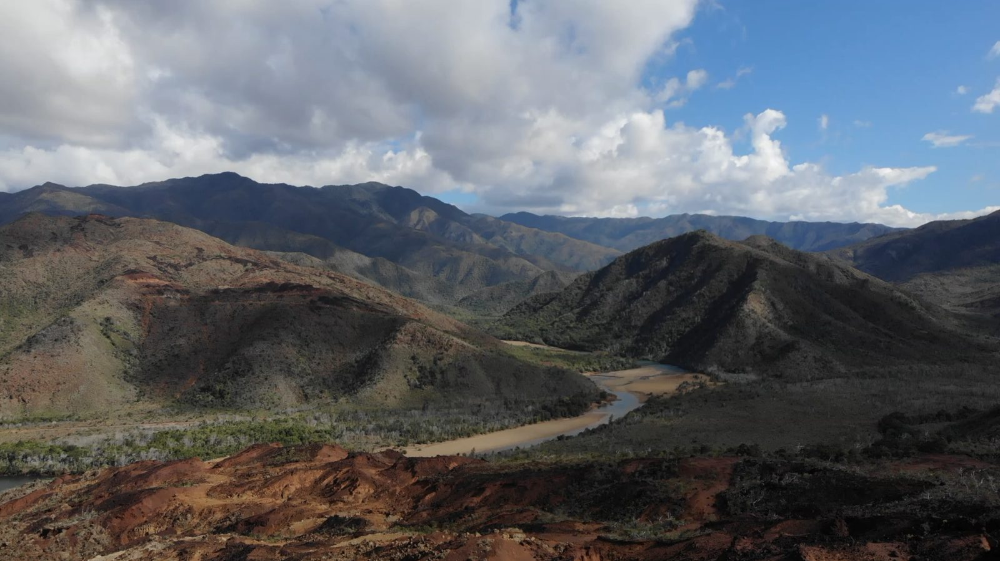
:::
:::

## La flore endémique au cœur de ces projets

::: {.grid}
::: {.g-col-4}

:::
::: {.g-col-4}
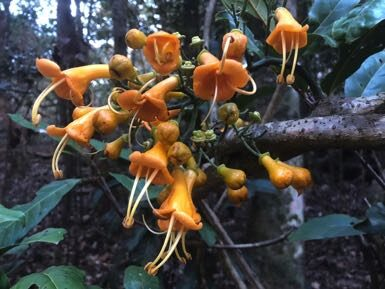
:::
::: {.g-col-4}

:::
:::

