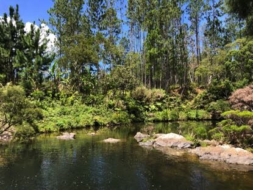
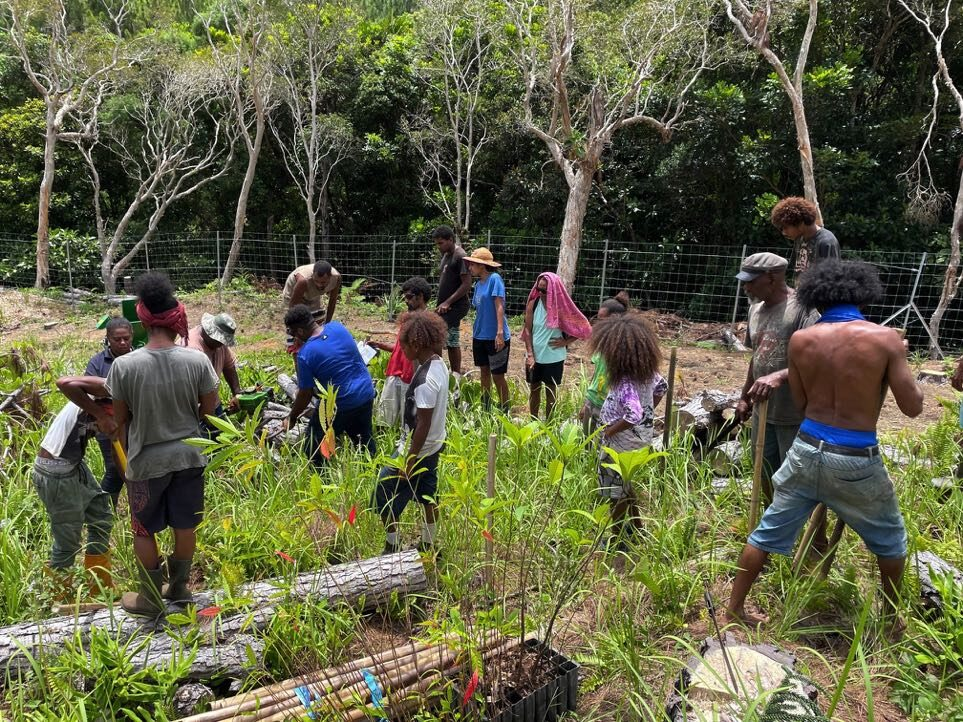
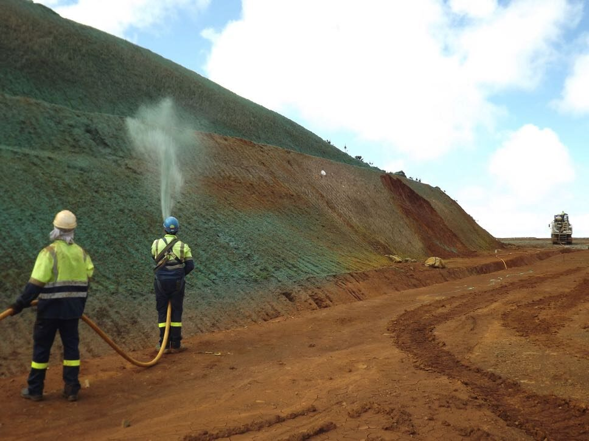
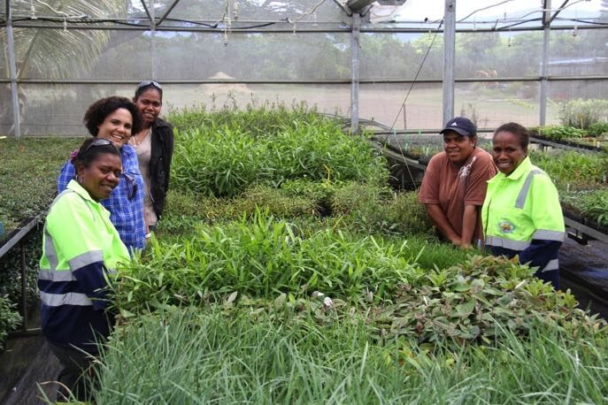
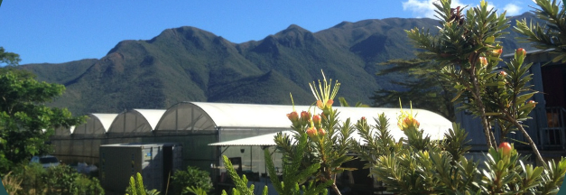
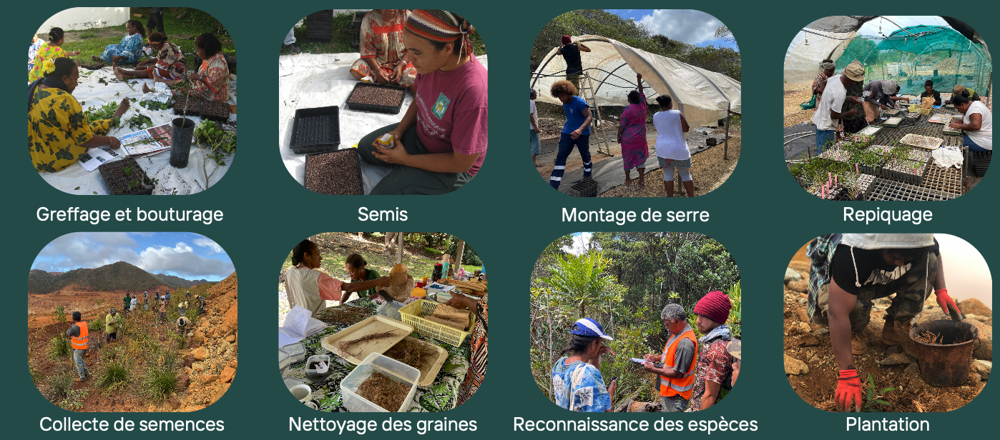
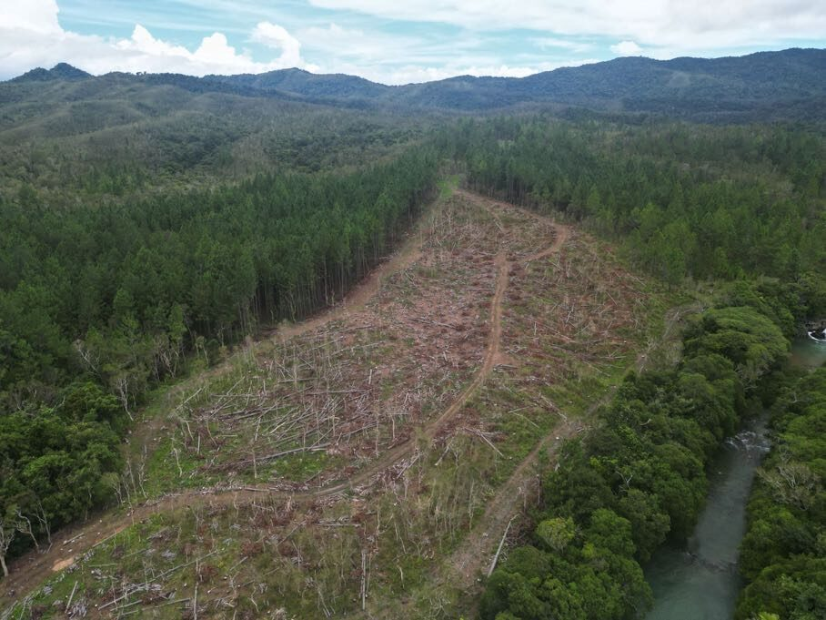
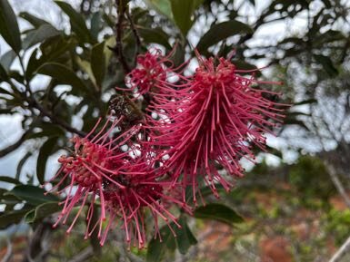
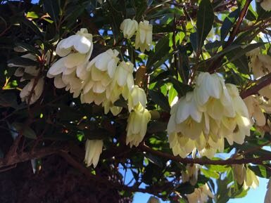

Une sélection de projets menés au sein de mes entreprises en
Nouvelle-Calédonie (2003-2023), puis dans le cadre de ma spécialisation
en géomatique (depuis 2023). Cliquez sur une photo pour l'agrandir.

## Réhabilitation écologique — Nouvelle-Calédonie

::: {.grid}
::: {.g-col-12 .g-col-md-7}
### Restauration de la forêt sèche
Côte Ouest, 2009-2020 — pour l'Agence néo-calédonienne de la biodiversité
et Koniambo Nickel SAS.
Production et plantation de plus de 25 000 plants par an, semences
collectées aux abords des zones à restaurer, expérimentation d'itinéraires
techniques et mise en défens anti-cerfs.
:::
::: {.g-col-12 .g-col-md-5}

:::
:::

::: {.grid}
::: {.g-col-12 .g-col-md-7}
### Réhabilitation du bassin versant du creek Mindaï
Tribu de Bâ, Houaïlou, 2021-2023 — commune de Houaïlou, projet PROTEGE.
Suppression de 10 ha de pins envahissants, reboisement de 12 ha avec
12 000 plants endémiques, 2 000 mètres de clôtures anti-cerfs et cochons,
participation des populations locales aux plantations et au suivi.
:::
::: {.g-col-12 .g-col-md-5}

:::
:::

::: {.grid}
::: {.g-col-12 .g-col-md-7}
### Revégétalisation du maquis minier
2003-2023 — acteurs miniers et collectivités (KNS, Ballande, NMC...).
Production annuelle de 80 000 plants endémiques, plantation de 30 000
plants par an, semis hydraulique (20 000 m² par an), pose de boudins et
géofilets, travaux sur corde, suivi phénologique d'espèces rares.
:::
::: {.g-col-12 .g-col-md-5}

:::
:::

::: {.grid}
::: {.g-col-12 .g-col-md-7}
### Production de plants endémiques
Pépinières de Kataviti (Koné) et de la tribu de Tiwae (Touho), 2003-2023.
Capacité de 200 000 plants, environ 300 espèces produites, recherche sur
la multiplication des espèces endémiques.
:::
::: {.g-col-12 .g-col-md-5}

:::
::: {.g-col-12 .g-col-md-12}

## Formation & accompagnement

::: {.grid}
::: {.g-col-12 .g-col-md-7}
### Formations aux métiers du végétal et de la restauration
CFPPA de Pouembout, 2010-2020 — environ 50 h par an, 8 à 12 apprenants
par module : semis, greffage, repiquage, collecte de semences,
reconnaissance d'espèces, plantation.
:::
::: {.g-col-12 .g-col-md-12}

:::
:::

::: {.grid}
::: {.g-col-12 .g-col-md-7}
### Chantier école de revégétalisation
Ancien site minier de Bel-Air, Houaïlou, 2022 — Fonds Nickel, DIMENC.
3 238 plants d'espèces indigènes et endémiques, 1 821 m² de semis
hydraulique, formation des participants aux techniques de plantation.
:::
::: {.g-col-12 .g-col-md-5}

:::
:::

## Géomatique & applications

### Application web de diagnostic de déforestation
Mission professionnelle, Nitidæ, Montpellier, 2026-2027.
Conception et développement d'une application de diagnostic
« zéro-déforestation » sur parcelles cultivées, dans le contexte du
règlement européen RDUE : croisement de cartes forestières de référence,
traitement de lots de plusieurs milliers de parcelles, rapports
automatisés, protection des données personnelles.

::: {.grid}
::: {.g-col-12 .g-col-md-7}
### Cartographie et suivi par drone et satellite
Terra Native Consulting, depuis 2023.
Production de cartes et d'images drone et satellite pour le suivi de
projets environnementaux.
:::
::: {.g-col-12 .g-col-md-5}

:::
:::

## La flore au cœur de ces projets

::: {.grid}
::: {.g-col-4}

:::
::: {.g-col-4}

:::
::: {.g-col-4}

:::
:::

*Cartes de démonstration sur données publiques : à venir.*
